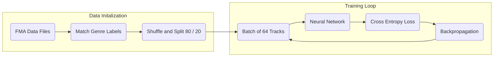

# GenreClassifer

## Setup (Linux)

```bash
git clone "https://github.com/aiden-carroll/GenreClassifer"
cd GenreClassifier
pip install virtualenv
virtualenv .venv
source .venv/bin/activate
.venv/bin/pip install -r requirements.txt
```

## Setup (Windows)

```bash
git clone "https://github.com/aiden-carroll/GenreClassifer"
cd GenreClassifier
pip install virtualenv
virtualenv .venv
./.venv/Scripts/activate
pip install -r requirements.txt
```

## Setup Training Data

1. Download the [fma_metadata.zip](https://os.unil.cloud.switch.ch/fma/fma_metadata.zip)
2. Unzip the folder to get the .csv files
3. Create a **data** subfolder inside the repo root
4. Create a **fma** subfolder inside the **data** folder
5. Move **features.csv** from the download to **data/fma** folder
6. Move **genres.csv** from the download to **data/fma** folder
7. Move **tracks.csv** from the download to **data/fma** folder

## Setup Caching

Create a cache folder inside the repo root

## Resources

### Training Pipeline Diagram



### Testing Library

<https://www.geeksforgeeks.org/python/unit-testing-python-unittest/>

## Specifics

### Loss Function

#### Symbol meanings

| Symbol        | Meaning                                       |
|---------------|-----------------------------------------------|
|    N          | Number of tracks                              |
|   i           | Which track from 1 to N                       |
| $y_i$         | True genre of track given as id               |
| $p_{i,\,y_i}$ | Probability of model to give matching true id |

#### Functions

We are using standard cross-entropy given from the following function:

$$L = \frac{1}{N}\sum_i -\log p_{i,\,y_i}$$

### Optimization

The optimization follows the Adam's algorithm

This uses a running count of squared gradients, dividing it by the square root. This lessens the gradient count to fit within a
32 bit float, while keeping or improving the accuracy

#### One varible example

In the function: $f(x) = (x-3)^2$

the gradient is: $f'(x) = 2(x-3)$

so we find the local minima: $x=3$

#### We apply this to the loss function

Using PyTorch's `loss.backwards()` function we break the function down for us and find its gradiant (internally using the chain rule).
